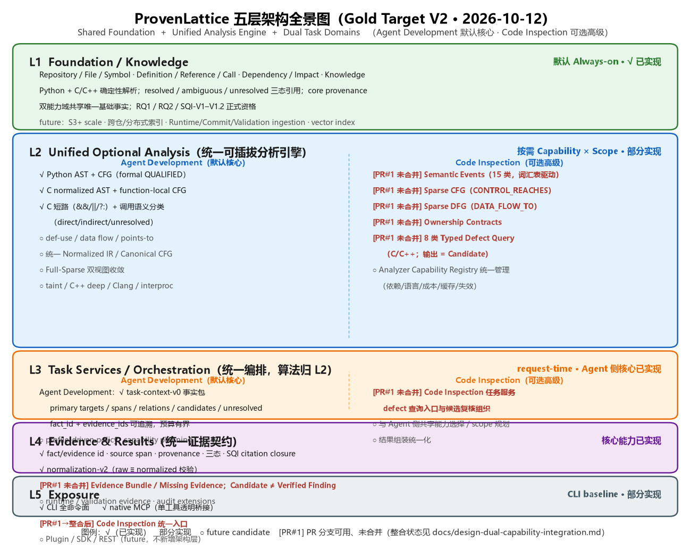

# ProvenLattice

**A Provenance-aware Layered Engineering Evidence Graph for Code Agents**

ProvenLattice 是一个面向 Code Agent 的研究型工程上下文与证据图项目。

项目希望探索：如何将代码仓库中的结构信息，与规范、文档、开发历史和运行时信息进行关联，为 Code Agent 提供更加结构化、可追溯、面向任务的工程上下文。

**产品定位（Gold Target V2，2026-10-12）**：统一程序知识和语义分析平台——以轻量、确定性、可增量的代码知识图谱为基础，支持两大能力域：

* **Agent Development（日常开发辅助，默认核心）**：代码理解、调用关系与影响分析、Agent 编码/修复辅助、需求-代码关联、任务上下文生成；
* **Code Inspection（深度代码检测，可选高级）**：资源生命周期、空指针/UAF/Double Free、锁与竞态、Def-use/Data Flow/Ownership/Taint、Typed Defect Query 与 Evidence Bundle 复核。

两大能力域共享底层事实、分析引擎和证据体系，不发展成两套独立的 CodeGraph。长期规划见 [docs/roadmap.md](docs/roadmap.md) Gold Target V2 节；main 与 PR #1 的整合审计见 [docs/design-dual-capability-integration.md](docs/design-dual-capability-integration.md)。

## Motivation

当前 Code Agent 主要通过文件读取、代码搜索和工具调用理解大型代码仓库。

随着代码规模和工程复杂度增加，这种方式容易带来：

* 大量重复搜索与文件读取
* 跨文件、跨模块关系定位成本较高
* 代码与需求、设计、历史信息相互割裂
* Agent 上下文快速膨胀
* 大型仓库中的任务探索路径较长

ProvenLattice 希望探索一种新的工程上下文组织方式：

> 将软件工程中的多源信息组织成可查询、可追溯的分层证据结构，并为 Code Agent 提供任务相关的最小必要上下文。

## Reproducibility Baseline

当前资格结论（RQ1/RQ2/SQI-V1/SQI-V1.2）与一键验证入口见 **[REPRODUCIBILITY.md](REPRODUCIBILITY.md)**。

最新发布：**SQI-V1.2 = QUALIFIED / RELEASE READY**（2026-09-20，tag
`provenlattice-sqi-v1.2`）——SQI 18/18、9/9 frozen floors、单 backend 完整
clean batch；成本相对 V1.1 baseline：input -36% / output -58% /
cache-read -73%。详见 `docs/releases/sqi-v1.2.md`：

```bash
python experiments/query_interface_v1/tools/verify_release.py
```

当前开发态：**Post-V1.2 = Optional Function Analysis Layer + Context Bundle**
（已集成 main；development checkpoint，非正式 V1.3 qualification）——Foundation
Graph 之上加入可选
AST/CFG 分析层（D0–D8）、`task-context` 事实包（D9-C1/C2）、native MCP
暴露（D9-C7/C8）、normalization-v2（D9-C9），并完成 D9-C10 六 case × 双臂
受控能力稳定性实验（12/12 cells、6/6 pairs VALID）。新增能力边界如实记录：
AST/CFG 分析层当前支持 Python AST/CFG，并新增可选 C `.c`/`.h` normalized
AST、函数内 C CFG V1（含 `&&`/`||`/`?:` 短路）、调用语义分类
（direct/indirect/unresolved）与定义优先的紧凑符号上下文；C++ deep
analysis、精确 function-pointer target 解析、points-to、def-use、taint、
Clang/compile_commands 增强与跨过程 CFG 仍不支持。ContextBench zstd 16-case
重验 **14/16 解决、0 真实失败、
2 case 因验证环境限制排除**（详见 `experiments/analysis_layer/d8/results/`
与 `benchmark-contextbench-zstd/` 外部批目录）。

> **整合线（2026-10-12，规划冻结）**：PR #1（缺陷导向稀疏语义程序图——
> Semantic Events、Sparse CFG/DFG、Ownership Contracts、8 类 Typed Defect
> Query、Evidence Bundle 与冷存储分离）**尚未合并**；其能力映射、与 main
> 分析层的语义差异审计、三臂对照实验设计与渐进整合路线见
> [docs/design-dual-capability-integration.md](docs/design-dual-capability-integration.md)。
> 在合并并取得对应证据之前，上述能力不作为已交付能力表述。

## Qualification & Development Evidence（基座 → Agent 证据链）

ProvenLattice 的能力不是 demo 叙事，而是按

```text
图构得出来 → 图事实正确 → 大仓可运行 → 增量仍正确 → Agent 可消费 → 成本可控
```

逐层取得正式资格与 Post-V1.2 development evidence（全部数字来自冻结 artifact，各项状态按自身证据等级 formal / controlled / diagnostic 标注，详证见
[experiments/foundation_analysis/reviews/provenlattice-foundation-evidence-review.md](experiments/foundation_analysis/reviews/provenlattice-foundation-evidence-review.md)）：

| 验证线 | 回答的问题 | 正式结果 | 状态 |
| --- | --- | --- | --- |
| RQ1 图保真度 | 图里的事实能不能信？ | 174 例双盲 Gold（CALLS 86 / IMPORTS 88）；resolved precision **0.931**（样本）/ **0.899**（加权）；覆盖（尤其 CALLS）是主要限制而非错选 | **QUALIFIED**（2026-09-15，限 V0.2 / C-C++ / CALLS+IMPORTS / 三仓） |
| RQ2 系统与规模 | 大仓能否构建、增量是否一致？ | aria2 118.9k / brpc 227.2k / RocksDB 622.8k C/C++ LOC；21 条正式记录；**36/36 增量 rep 六状态层 exact parity**；A/B 计数精确落冻结锚点 | **QUALIFIED**（2026-09-16，Contract V1 scope） |
| SQI 结构化查询 | 图能否被 Agent 稳定查询？ | SQI **18/18** vs Native 13/18（V1）/ 12/18（C4-R4 对照）；citation closure 18/18 | **QUALIFIED**（V1 + V1.2） |
| V1.2 成本优化 | Agent 消费成本是否可控？ | input −36% / output −58% / cache-read −73%；T05 调用数 6–20/rep → 5/2/6 | **QUALIFIED / RELEASE READY** |
| 分析层 D0–D8 | AST/CFG 能否被真实 Agent 消费？ | UTILITY_OBSERVED 4/6、ADOPTION_GAP 2/6、CAPABILITY_GAP 0；Base Graph 零影响回归 137/137 | **QUALIFIED（Python-only）**（2026-09-22） |
| D9-C10 P2 稳定性 | 双臂受控下能力是否稳定无泄漏？ | 6 case × 2 arm × r1 = 12/12 cells、6/6 pairs VALID、Arm A facts=0 ×6、Arm B facts>0 ×6、0 leakage/hidden retry | **PASS**（2026-10-09） |
| ContextBench zstd 16-case 重验 | 新版本是否回归？ | **14/16 resolved、0 真实失败、2 infra-excluded**（官方 reference fix 同样无法在该验证环境完成）；历史 3 个失败 case 对账 = 全部 harness 苛判产物 | **NO REGRESSION**（2026-10-09） |

同批横向对照（C4-R4 clean batch，单 backend deepseek-flash ×36）：SQI 任务成功率
100% vs Native 66.7%；按成功任务归一后上下文成本 **−28.1%**。Native 失败的
恰好是两张图依赖型任务（完整 caller 枚举、impact frontier）。详见
[experiments/query_interface_v1/reviews/c4-r4-native-vs-sqi-v1.2.md](experiments/query_interface_v1/reviews/c4-r4-native-vs-sqi-v1.2.md)。

诚实边界：Overlay = IMPLEMENTED / PARTIALLY QUALIFIED（V0.4 工程
parity/conflict 证据，未进冻结正式资格，V1.1 NOT STARTED）；增量延迟当前
**高于**全量构建（正式记录在案、非门禁观察）；核心图查询 p95/p99、并发
QPS、10M+ LOC、跨仓统一索引、向量索引、分布式同步 = 未测/未实现。

## Post-V1.2 开发态：五层能力栈

当前开发态（已集成 main）把系统组织为五层，逐层可选、逐层有证据：

```text
L1 基础图层 Foundation Graph（默认，常驻；双能力域共享唯一事实）
│   index/update → Repository/File/Symbol/Call/Reference/Impact/Knowledge
│   确定性解析：Python + C/C++，resolved/ambiguous/unresolved 三态引用
│
L2 统一可选分析层 Unified Optional Analysis（可选，按 Capability × Scope 物化）
│   analyze --scope <dir> --features ast,cfg
│   Function IR + 局部 CFG（真回边、return/break/continue、callsite 不跨函数）
│   six-state 只读查询（available/not_built/stale/unsupported/…）
│   Python: AST + CFG；C (.c/.h): normalized AST + function-local CFG（含 &&/||/?: 短路）+ 调用语义分类（direct/indirect/unresolved）；C++ deep analysis: unsupported
│   [PR #1 未合并] Semantic Events + Sparse CFG/DFG + Ownership Contracts + 8 类 Typed Defect Query（C/C++）
│
L3 任务服务层 Task Services / Orchestration（统一编排，双业务入口）
│   Agent Development：task-context <symbols> --json → task-context-v0 事实包
│     primary_targets / source_spans / relations / candidates / unresolved
│     每条 fact 带 fact_id + evidence_ids（可追溯，无合成 ID）
│   Code Inspection：defect 查询与候选复核组织（随 PR #1 整合交付，未合并）
│
L4 证据与结果层 Evidence & Results（统一证据契约）
│   evidence 链（E-CALL-*/E-REF-*）、SQI citation closure
│   normalization-v2：Agent trace → 事实级观测（raw≡normalized 校验）
│   [PR #1 未合并] Evidence Bundle / Missing Evidence；Candidate ≠ Verified Finding
│
L5 暴露层 Exposure
│   CLI：python -m provenlattice <command>（见下表）
│   MCP：native 单工具暴露 mcp__provenlattice__query（透明桥接，C8-A 冻结合约）
│   Agent Query 与 Code Inspection 统一入口（Inspection 入口随整合交付）
```

### 五层架构全景图（实现状态 × 任务覆盖）



*ProvenLattice 五层架构全景图（Gold Target V2 双能力域口径，2026-10-12）*

> 注：图片为示意版；各层实现状态与证据等级**以下方文字版为准**（文字版统一口径：L3 / L4 = 核心能力已实现，L5 = 部分实现）。图中 PR #1 相关能力为规划整合目标，未合并前不视为已交付。

图例：✅ 已实现　◐ 部分实现　⬜ 未实现（future candidate，见 roadmap §4）　🔀 PR #1 分支可用、未合并（整合状态见 [docs/design-dual-capability-integration.md](docs/design-dual-capability-integration.md)）

> 实现状态与证据等级是两个维度：`已实现` 表示代码能力已存在；`formal / controlled / diagnostic` 表示该能力目前拥有的验证证据等级。

```text
L1 Foundation / Knowledge      ✅ 已实现
│   ✅ Python + C/C++ 基础解析、Symbol / Definition / Reference / Call、
│      resolved / ambiguous / unresolved 三态引用、Impact、Knowledge
│   ✅ 相关 foundation/query 能力已有 RQ1 / RQ2 / SQI-V1/V1.1/V1.2 正式证据支撑
│   ⬜ S3+ scale / 跨仓统一索引 / 分布式索引
│   ⬜ Runtime Log / Commit History / Validation Result ingestion（→ L1 + L4）
│   ⬜ Vector index：
│      repository-level canonical index → L1；
│      task-context retrieval accelerator → L3
│
L2 Unified Optional Analysis    ◐ 部分实现
│   ✅ Python AST + CFG（formal QUALIFIED）
│   ✅ C normalized AST + function-local CFG（含 && / || / ?: 短路）
│      + 调用语义分类（direct / indirect / unresolved）
│      （A1–A3.6：diagnostic / regression validated）
│   ⬜ def-use / local data flow（当前真实任务尚未证明必须，A4_DEFUSE_NOT_YET_JUSTIFIED）
│   ⬜ points-to / 精确 function-pointer target
│      （当前只识别 indirect call，不解析 concrete target）
│   ⬜ 统一 Normalized IR / Canonical CFG / Full-Sparse 双视图收敛（Gold Target V2）
│   ⬜ taint / security analysis（main 侧未启动）
│   ⬜ C++ deep analysis
│   ⬜ Clang / compile_commands-aware semantic enrichment
│   ⬜ interprocedural CFG
│   🔀 PR #1（未合并）：Semantic Events（15 类）+ Sparse CFG/DFG +
│      Ownership Contracts + 8 类 Typed Defect Query（C/C++，Candidate 输出）
│
L3 Task Services / Orchestration ✅ 核心能力已实现（Agent Development 侧）
│   ✅ task-context-v0
│   ✅ primary targets / source spans / relations / candidates / unresolved
│   ✅ definition-preference、symbol-scoped compact analysis summary、预算有界
│   ✅ controlled protocol 中已验证事实可达与稳定性
│   ⬜ profile-driven capability policy
│   ⬜ semantic/vector retrieval accelerator
│   ⬜ automatic capability planning
│   🔀 PR #1（未合并）：Code Inspection 任务服务（defect 查询入口与复核组织）
│
L4 Evidence & Results           ✅ 核心能力已实现
│   ✅ Core provenance：fact_id / evidence_ids / source span / 三态引用
│   ✅ SQI citation closure
│   ✅ normalization-v2 + raw≡normalized 校验
│   🔀 PR #1（未合并）：Evidence Bundle / Missing Evidence 分类；
│      Candidate / Uncertain / Verified Finding 区分契约
│   ⬜ Runtime evidence provenance
│   ⬜ Validation-result evidence
│   ⬜ richer normalization / audit extensions
│
L5 Exposure                    ◐ 部分实现
│   ✅ CLI（baseline，全命令面）
│   ✅ native MCP（可按配置启用）
│   ⬜ Code Inspection 统一入口（随整合交付）
│   ⬜ Plugin
│   ⬜ SDK
│   ⬜ REST / API service
```

**已实现部分当前可覆盖的任务**

| 层 | 当前可覆盖任务 |
| --- | --- |
| L1 | 代码理解、definition/reference/caller/callee 查询、依赖与影响面分析、需求/文档→代码定位、日常 bug 定位、review / refactor 辅助 |
| L2（Python/C 已有 analyzer） | 函数内部结构理解、复杂函数解释、局部控制流分析、条件/循环/return/break/continue/switch/fallthrough 路径理解、C 短路求值结构、direct/indirect/unresolved call 识别 |
| L3 | 针对 Agent 任务按需选择并打包 primary targets / spans / relations / analysis summary，控制上下文规模 |
| L4 | 事实来源追溯、resolved/ambiguous/unresolved 状态保真、citation closure、Agent trace 规范化与实验审计 |
| L5 | CLI 直接消费全部查询/分析能力；MCP 客户端原生接入 ProvenLattice |

**未实现能力及其潜在任务价值**

> 以下均为 future candidates，不表示已排期或已证明必须；是否启动仍遵循 evidence-driven 原则。
> 本表只描述 **main 已集成范围**；PR #1 分支已有的检测类能力（Semantic Events /
> Sparse CFG/DFG / Defect Queries）属整合决策范围，见
> [docs/design-dual-capability-integration.md](docs/design-dual-capability-integration.md)。

| 未实现能力 | 潜在任务价值 |
| --- | --- |
| def-use / local data flow | 提供 parameter → local → branch → store / call 的值流基础，用于更精确的数据依赖理解，并为后续空指针、未初始化值、危险输入分析提供基础 |
| points-to / 精确 function-pointer target | 收敛 callback / function pointer 的 concrete target，提升间接调用定位和相关修复任务精度 |
| taint / security analysis | source → propagation → sink / sanitizer 路径、漏洞检测、安全审计、finding 解释与修复辅助 |
| C++ deep analysis | C++ 函数内部 AST / CFG / 调用语义分析；当前 C++ 仅有 Foundation Graph |
| Clang / compile_commands 增强 | 在宏、模板、复杂重载、类型绑定、跨翻译单元场景下提高 C/C++ 语义精度 |
| interprocedural CFG | 跨函数控制路径、跨调用链流程理解；当前 CFG 明确限定为 function-local |
| Runtime / Commit / Validation ingestion | 将运行时、开发历史和验证结果作为新的工程证据源接入 L1，并通过 L4 保留 provenance |
| Plugin / SDK / REST | IDE、平台和第三方工具的程序化集成 |
| Capability Profiles | `basic / development / deep / security` 等能力组合配置；属于 future productization target，不改变五层架构 |

> **架构原则：** 五层表示数据生命周期阶段，而不是能力成熟度等级（Layer ≠ Maturity Level）。\
> AST、CFG、def-use、points-to、taint 等即使复杂度逐步提高，仍属于 L2 Analysis；新增 analyzer 不意味着新增架构层。\
> 长期产品化目标见 [docs/roadmap.md](docs/roadmap.md) 的 Gold Target V2 节（双能力域：Agent Development + Code Inspection）。

### 支持的操作（CLI 命令面）

| 类别 | 命令 | 说明 |
| --- | --- | --- |
| 建图/维护 | `index` `update` `status` `shard` | 全量/增量索引、状态查询、分片 |
| 分析层 | `analyze` `analysis` | 按 scope 物化/查询派生分析；Python AST/CFG，C `.c`/`.h` AST + function-local CFG + 调用语义分类 + 紧凑符号上下文（`get_analysis_summary`）；C++ deep analysis unsupported |
| 事实包 | `task-context` | 面向 Agent 的上下文事实包（L3 主入口） |
| 符号查询 | `symbol` `definition` `callers` `callees` `references` | SQI 结构化查询 |
| 结构关系 | `dependencies` `dependents` `subgraph` `impact`（经 symbol/related） | 模块依赖与影响面 |
| 知识层 | `knowledge` `document` `implemented` `requirements` | Spec/Requirement → 代码跨层证据 |
| Agent 消费 | `explain-symbol` `explain-module` `find-related-code` `find-related-documents` `trace-evidence` | 解释、关联与证据追溯（`--analysis ast,cfg` 可选附加） |
| MCP | `mcp__provenlattice__query`（单工具，`command`+`args` 透传） | Claude Code 等 MCP 客户端原生使用 |

## Research Direction

当前主要关注以下方向：

* 大规模代码结构建模
* 分层工程信息组织
* 跨层工程证据关联
* 增量图更新
* 多版本与多人协作场景
* 面向 Code Agent 的结构化检索
* Graph-guided Context Retrieval
* Code Agent 工程证据检索质量与效率

## Vision

ProvenLattice 希望让 Code Agent 面对的不再只是：

```text
Files + Text
```

而是一个能够表达工程关系与演化信息的：

```text
Structured Engineering Context
```

最终探索：

> **更少搜索、更短任务路径、更高信息密度，以及更低的 Agent 上下文成本。**

Token、读取字符数和工具轮次在实验中作为检索效率的辅助观测指标，不是 ProvenLattice 的独立产品职责。

## Standalone Roadmap

ProvenLattice 与 TASCO 是两个独立工具。ProvenLattice 的版本、接口和实验不依赖 TASCO；未来如有组合实验，将在两个工具各自完成独立验证后另行定义。

```text
Core V0.3  Shard / Incremental Foundation                      ✅
Core V0.4  Branch / Session Overlay                            ✅（工程级 parity；正式资格 V1.1 NOT STARTED）
V1.0      Knowledge Layer / Cross-Layer Evidence               ✅
RQ1       Graph Fidelity Qualification V1                      ✅ QUALIFIED（2026-09-15）
RQ2       Systems + Scale Qualification V1                     ✅ QUALIFIED（2026-09-16）
SQI-V1    Structured Query Interface Qualification             ✅ QUALIFIED（2026-09-17）
SQI-V1.1  Evaluation Hardening                                 ✅ PASS（2026-09-17）
SQI-V1.2  Cost Optimization Qualification                      ✅ QUALIFIED / RELEASE READY（2026-09-20）
Analysis Layer D0–D8                                          ✅ QUALIFIED Python-only（2026-09-22）
Context Bundle / task-context-v0（D9-C1/C2）                    ✅（已集成 main）
Native MCP Exposure（D9-C7/C8）                                 ✅ 单工具透明桥接 + 冻结合约
Normalization-v2（D9-C9）                                       ✅ raw≡normalized 校验
D9-C10 P2 受控能力稳定性（6 case × 2 arm）                       ✅ PASS（2026-10-09）
ContextBench zstd 16-case 重验                                  ✅ 14/16、0 真实失败、2 infra-excluded
C 分析链 A1–A3.6（AST/CFG/短路/调用语义/紧凑上下文）              ✅ 已集成 main（diagnostic）
Gold Target V2 双能力域统一架构（Agent Dev + Code Inspection）   📋 规划冻结（2026-10-12，docs/roadmap.md）
PR #1 缺陷语义层（Events/Sparse CFG/DFG/Defect/冷存储）          🔀 PR 分支可用、未合并（整合路线见 design-dual-capability-integration.md）
三臂对照实验（main / PR #1 / 统一原型）                          planned，未执行（design doc §8）
Colleague 16-case rerun（R1 revalidation）                      next experiment（结果不预写）
V1.3 正式 qualification 汇总 + tag                              pending（revalidation 之后收敛）
V1.4      Def-Use / Local Data Flow / Finding Enrichment       not justified yet（A4_DEFUSE_NOT_YET_JUSTIFIED）
V1.4a     C normalized AST（`.c`/`.h`）                         ✅ A1 implemented（已集成 main）
V1.4b     C CFG V1 + 表达式短路（&&/||/?:）                     ✅ A2/A2.1 implemented（已集成 main）
V1.4c     C 调用语义分类（direct/indirect/unresolved）          ✅ A3 implemented（已集成 main）
V1.4d     C++ deep analysis                                     future candidate
V1.4e     精确 function-pointer target / points-to              future candidate（当前仅 indirect 识别）
V1.5     Taint / Security Analysis                            future candidate
Clang / compile_commands 语义增强                               future candidate
Overlay V1.1                                                   next candidate
S3+ scale bands / concurrency                                  not started
第四个 benchmark 仓库 / 跨仓统一索引 / 向量索引                  not started
MCP / Plugin / SDK        MCP 已落地（native exposure）；Plugin/SDK  evidence-driven decision
```

## Current Goal: Dual-Capability Integration（Gold Target V2）

当前目标（2026-10-12 冻结）：将 main（Agent Development 线）与 PR #1（Code
Inspection 线）统一到 **Gold Target V2** 的长期产品架构——**统一程序知识和
语义分析平台**：Shared Foundation + Unified Analysis Engine + Dual Task
Domains。权威规划见 [docs/roadmap.md](docs/roadmap.md) Gold Target V2 节；
实现差异审计、能力映射、语义差异矩阵、三臂对照实验与 Phase 1–5 整合路线见
[docs/design-dual-capability-integration.md](docs/design-dual-capability-integration.md)。**PR #1 未合并；Phase 1（基线审计）尚未启动。**

此前的 Optional Function Analysis Layer 目标（分析层设计全文见
[docs/design-optional-analysis-layer-vision.md](docs/design-optional-analysis-layer-vision.md)）已作为 V2 的 L2 Unified Optional Analysis 在
Agent Development 侧的已交付部分继续有效：

在 V1.2 Foundation Graph 契约不变的前提下，引入**可选的函数内分析层**
（AST / CFG / 后续 Def-Use、Data Flow、安全分析），面向代码检测、安全分析
与高级 Agent 任务。**L1 默认常驻；L2 高成本
分析按 Capability × Scope 按需物化；L3 按任务调用；L4 Core Provenance 与
L5 CLI 保持 baseline，其余增强能力/adapter 按需启用。**通过渐进增强平衡
能力、延迟、存储与上下文成本；五层 = 数据生命周期阶段（Layer ≠ Maturity
Level），当前不规划 L6。

分析层已按 D0–D8 完成实证交付并集成 main（报告见 `docs/design-analysis-layer-d*.md`）：

- **Analysis 默认 OFF / Base Graph 默认路径不变承诺**：analysis 表惰性创建、基础源码零修改，未请求分析时 index/update 基础行为不变（每阶段零影响测试 + 全量回归 137/137）；
- **D1–D3**：`file × analyzer` 派生缓存（`ast:python` / `cfg:python`）、fail-closed freshness、payload 硬上限；
- **D2/D4**：第一条真实能力链——Python AST（函数体全量层级）与 intraprocedural CFG（真回边、return/break/continue 无 fallthrough、callsite 不跨函数）；
- **D5**：`provenlattice analyze <repo> --scope <dir> --features ast,cfg`（orchestrator，feature/scope 校验先于 mutation，CFG→AST 依赖编排）；
- **D6**：只读查询层 `analysis`（六态契约 available/not_built/stale/unsupported/not_available/corrupt，查询永不隐式 analyze）；
- **D7**：Agent 消费——`explain-symbol --analysis ast,cfg`（默认调用零变化 + size guard + 六态透传）；
- **D8**：真实 Agent 任务观察——UTILITY_OBSERVED=4 / ADOPTION_GAP=2 / CAPABILITY_GAP=0（无 DFG 需求信号）；
- **D8-RV1**（2026-10-09）：历史 ADOPTION_GAP case（A2 merge/fallthrough、B2 break-vs-return）新版本自然使用重验 → 两例均 CASE_SOLVED_WITHOUT_PROVENLATTICE（如实在案，不计能力 win）。

D9 context-bundle 线（已集成 main）：C6-C10 formal harness
（含 C8-A 冻结 MCP 暴露合约、C9 normalization-v2、C10 oracle-v2 与受控协议），
D9-C10 P2 = 12/12 cells、6/6 pairs VALID、PASS。

下一步（current next experiment）：colleague 16-case rerun——R1 revalidation
包/清单/指南已冻结（`revalidation/c-contextbench-zstd-r1-manifest.json`），
结果不预写；V1.3 正式 qualification 汇总待其之后再收敛。C 能力链
（AST/CFG/短路/调用语义/紧凑上下文）已集成 main（post-V1.2 checkpoint）；
def-use 真实 case 未证明必要（not justified yet），C++ deep analysis、
精确 function-pointer target 解析、points-to、taint、Clang/compile_commands
增强为后续候选（未排期）；DFG 等真实需求信号出现再启动。

接口路线：SQI 契约已冻结（byte-identical envelope + citation closure）；
**MCP 已落地**（D9-C8 native 单工具暴露，透明桥接 `python -m provenlattice`）；
Plugin / SDK 由后续使用证据决定。

**PR #1（Code Inspection 线，未合并）**：缺陷导向稀疏语义程序图——三层图模型
（Structural KG → Semantic Events → Defect Relations）、Sparse CFG/DFG、
Ownership Contracts、8 类 Typed Defect Query（`provenlattice defect`）、
Evidence Bundle 与冷/热存储分离。其与 main 分析层的重叠与差异（goto、短路、
indirect call、READ/WRITE identity、ownership/alias 等）已逐项审计并纳入
统一架构规划；**在 Phase 1/2 门槛通过并合并之前，上述能力不作为已交付能力**，
三臂对照实验（main / PR #1 / 统一原型）未执行，历史数字不可跨线直接比较。

## V1.0 Knowledge Layer

V1.0 在已冻结的 Core V0.4 上加入最小 Knowledge Layer，将 Markdown Spec、Requirement、Architecture 与 Document Section 复用同一套 Node / Edge / Overlay contract 接入 CodeGraph：

```text
scan -> parse -> graph -> shard -> SQLite -> query -> incremental update
```

V0.1 将语法引用持久化为 RawReference，明确区分 `resolved`、`ambiguous` 与 `unresolved`；只有证据充分的 resolved reference 才形成 Edge。V0.2 增加 `.h/.hpp/.c/.cc/.cpp` 等 C/C++ adapter，保守提取 namespace、class/struct、function/method、typedef/using、include 与 call expression，并保持 Full/Incremental parity。宏、模板实例化、虚调用与复杂重载允许保留 ambiguous/unresolved。

V0.4 的 Overlay SQLite 只保存 ADD/UPDATE/DELETE delta 与 tombstone；`GraphView` 统一按 Session > Branch > Base 合成查询，并提供 stale/rebase、session commit/discard、entity/boundary conflict detection 与 Full Materialization parity。V1.0 进一步把 Knowledge Node、Cross-layer Edge 与 RawEvidenceLink 纳入同一 Overlay。

Knowledge Layer 只使用显式 requirement ID、文件路径、qualified symbol 和 module anchor 等确定性证据。每条原始证据均保留 `resolved / ambiguous / unresolved`、候选、策略、provenance 与 confidence；只有唯一 resolved 证据生成跨层 Edge。当前不包含语义/Embedding/LLM linker。

V1.0 架构与 contract 见 [docs/design-v1.md](docs/design-v1.md)，V1.0-R1 实验契约见 [docs/design-v1-r1.md](docs/design-v1-r1.md)，完整路线见 [docs/roadmap.md](docs/roadmap.md)，R1 Harness 见 [experiments/retrieval-v1/README.md](experiments/retrieval-v1/README.md)，当前 qualification 状态见 [docs/benchmarks/provenlattice-v1.0-r1-retrieval.md](docs/benchmarks/provenlattice-v1.0-r1-retrieval.md)，真实仓结果见 [docs/benchmarks/provenlattice-v1.0-knowledge.md](docs/benchmarks/provenlattice-v1.0-knowledge.md)。V0.x 设计仍保留在 [docs/design-v0.md](docs/design-v0.md)。

### Quick start

```bash
python -m pip install -e .
provenlattice index /path/to/repo --json
provenlattice knowledge /path/to/repo --json
provenlattice status --database /path/to/repo/.provenlattice/codegraph.db --json
provenlattice symbol run --database /path/to/repo/.provenlattice/codegraph.db --json
provenlattice implemented REQ-RECOVERY-001 --database /path/to/repo/.provenlattice/codegraph.db --json
provenlattice evidence --status unresolved --database /path/to/repo/.provenlattice/codegraph.db --json
provenlattice update /path/to/repo --json
```

运行测试和完整 demo：

```bash
PYTHONPATH=src python -m unittest discover -s tests -v
PYTHONPATH=src python examples/demo/run_demo.py
```

Windows PowerShell 中先执行 `$env:PYTHONPATH='src'`。

## Status

✅ **SQI-V1.2 = QUALIFIED / RELEASE READY**（tag `provenlattice-sqi-v1.2`，GitHub Release 已发布）

🧪 **Post-V1.2 开发态（已集成 main）**：Analysis Layer（Python AST/CFG + C `.c`/`.h` normalized AST + C CFG V1）+
Context Bundle/`task-context` + native MCP 暴露 + normalization-v2 已合入；
D9-C10 受控稳定性 PASS；ContextBench zstd 16-case 重验无回归（14/16，0 真实失败）。
正式 V1.3 qualification 待 colleague 16-case rerun 后收敛，尚未宣称。

🔀 **Dual-Capability Integration（Gold Target V2，2026-10-12 规划冻结）**：
PR #1（Code Inspection 线）能力已审计并纳入统一架构规划，**未合并**；
三臂对照实验未执行；整合路线 Phase 1–5 见
[docs/design-dual-capability-integration.md](docs/design-dual-capability-integration.md)。

当前实现覆盖 Python/C/C++ CodeGraph，以及 Markdown Spec/Requirement/Document 到代码的可追溯确定性证据；RQ1 图保真度与 RQ2 系统规模资格已闭合，SQI 已完成 V1 → V1.1 → V1.2 三代 Agent 侧资格。Runtime Log、Commit History、Validation Result、Embedding、Vector DB、LLM linker、UI、TASCO、Plugin/SDK/REST 产品层尚未引入。

关键文档索引：

| 内容 | 位置 |
| --- | --- |
| V1.2 历史汇报 | [docs/report-v1.2.md](docs/report-v1.2.md) |
| Post-V1.2 综合报告 | [docs/report-post-v1.2.md](docs/report-post-v1.2.md) |
| 长期目标 Gold Target V2 | docs/roadmap.md（Gold Target V2 节，canonical planning entry） |
| Dual-capability 整合设计（main × PR #1 审计/映射/三臂实验/路线） | [docs/design-dual-capability-integration.md](docs/design-dual-capability-integration.md) |
| 基座能力证据链 | [experiments/foundation_analysis/reviews/provenlattice-foundation-evidence-review.md](experiments/foundation_analysis/reviews/provenlattice-foundation-evidence-review.md) |
| RQ1 图保真度综合 | experiments/fidelity_v1/results/rq1-graph-fidelity-evidence-synthesis-v1.md |
| RQ2 系统与规模综合 | experiments/systems_v1/results/rq2-cross-system-synthesis-v1.json |
| V1.2 发布文档 | docs/releases/sqi-v1.2.md |
| C4-R4 Native vs SQI 横向分析 | experiments/query_interface_v1/reviews/c4-r4-native-vs-sqi-v1.2.md |
| V1.3 分析层设计 | docs/design-analysis-layer-v1.3.md |
| 分析层 D0–D8 报告 | docs/design-analysis-layer-d4/d6/d7/d8-report.md |
| D8-RV1 历史失败 case 重验 | experiments/analysis_layer/d8/d8_rv1_runner.py + results/D8-RV1-* |
| D9-C10 受控实验协议 | experiments/context_bundle_v0/formal_harness/d9-c10/controlled-capability-protocol.json |
| D9 C6–C10 综合（adoption vs capability） | docs/context-bundle-d9-c6-c10-synthesis.md |
| C 真实 zstd diagnostic（A3.5） | docs/design-analysis-layer-c-a35-zstd-diagnostic.md |
| C 分析链 R1 集成审计 | docs/c-analysis-release-r1-integration-audit.md |
| R1 revalidation manifest | revalidation/c-contextbench-zstd-r1-manifest.json |
| Colleague 16-case revalidation guide | docs/c-analysis-colleague-revalidation-guide.md |

---

**ProvenLattice**

*Provenance-aware Layered Engineering Evidence Graph for Code Agents*
